<picture>
  <source media="(prefers-color-scheme: dark)" srcset="./assets/breakdown-hero-dark.svg">
  
</picture>

<b>Vijay Pandey</b> · VFX Compositor/Developer · Compositor

<a href="https://www.youtube.com/watch?v=uxAts_I17SA">▶ Showreel</a> &nbsp;·&nbsp; <a href="https://vijayvisuals.github.io/">vijayvisuals.github.io</a> &nbsp;·&nbsp; <a href="mailto:vijjubhai2001@gmail.com">vijjubhai2001@gmail.com</a> &nbsp;·&nbsp; <a href="https://x.com/https://x.com/_Vijay_Pandit_">X @https://x.com/_Vijay_Pandit_</a> &nbsp;·&nbsp; <a href="https://www.linkedin.com/in/vijay-pratap-pandey-70767517a/">LinkedIn</a>

**Logline.** A VFX Compositor at DNEG — one of the world's leading visual effects studios — with credits spanning Hollywood blockbusters and Indian tentpoles. Specialising in photorealistic CG integration, advanced compositing, and cinematic look development, delivering frames across Furiosa, Ghostbusters: Frozen Empire, Kalki 2898-AD, and the upcoming Ramayana.

**In production:** Working in DNEG as a VFX Compostor and ML Developer

#### Comp script

<picture>
  <source media="(prefers-color-scheme: dark)" srcset="./assets/breakdown-script-dark.svg">
  
</picture>

Reading the breakdown

- **The shot:** one tower per day of the last 12 months and one row per week, laid out like the contribution calendar (Sunday on the left). A tower is as tall as that day was busy, relative to your busiest day. This week is nearest the camera; the oldest week recedes toward the sun.
- **The passes:** wireframe, clay, normals and depth are the render passes a CG artist checks before a shot goes out. The hero wipes through them to the final beauty pass, the way a breakdown reel does.
- **The timeline:** one frame per day, from frame 1001 (where shots start) to 1365. Bar heights are daily contributions, and the diamond marks your busiest day.
- **Comp script:** the year is the background plate. Featured repositories are Read nodes merged over it, each with a material preview in its language colour. The result is graded, then written out as version v008: one version for every active day.
- **Colour chart:** language share by bytes across public repositories, above a grey ramp.
- **The end card:** an on-set lighting reference kit, with a grey ball, a chrome ball reflecting the shot's sunset and a colour chart.

Artwork: original animated SVG, generated by README Templates · template: Breakdown. Motion stops if your system asks for reduced motion.

#### Credits

- **[Asset-Browser](https://github.com/vijayvisuals/Asset-Browser)** · Asset Browser for VFX pipeline  
  Python · ★ 2
- **[vijayvisuals.github.com](https://github.com/vijayvisuals/vijayvisuals.github.com)** · portfolio  
  Python

**Toolkit:** Nuke, Blender, Python

<picture>
  <source media="(prefers-color-scheme: dark)" srcset="./assets/breakdown-end-dark.svg">
  
</picture>

